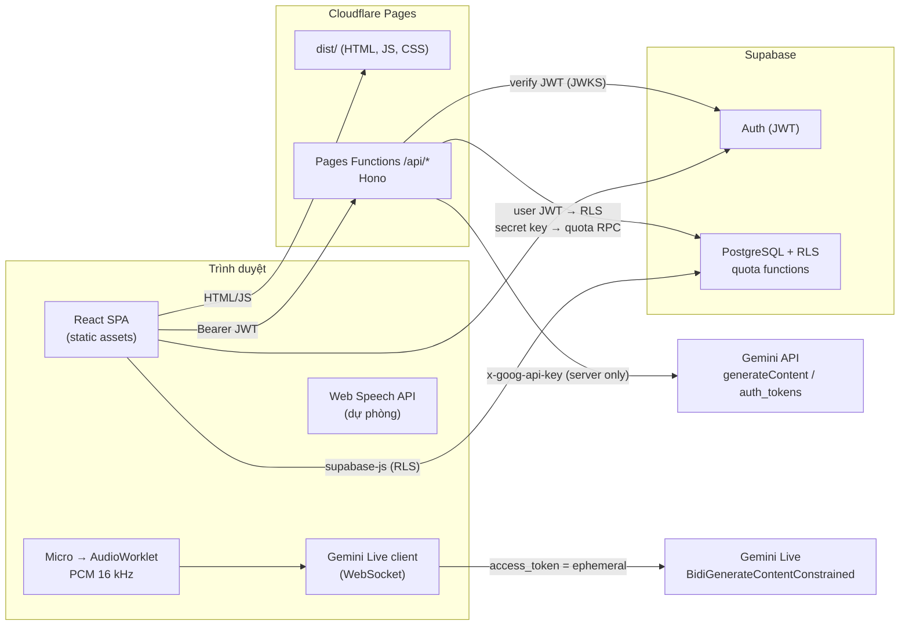
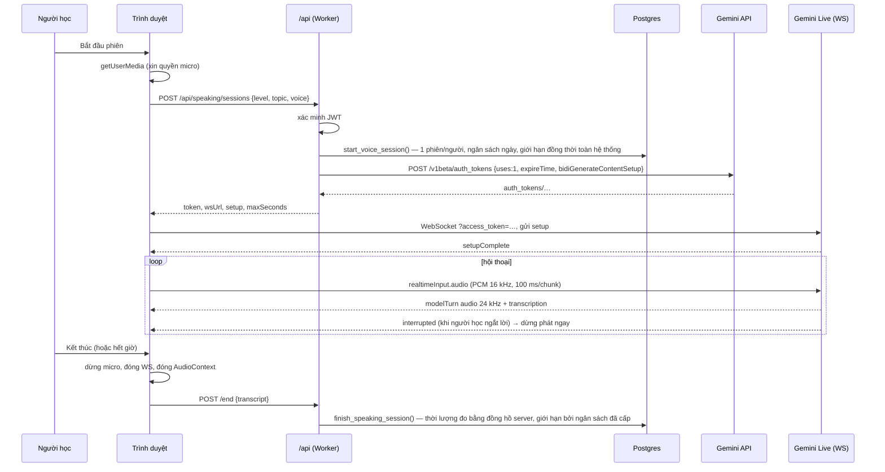

# Kiến trúc EnglishAI

## Tổng quan

- Frontend là site tĩnh. Đọc/ghi dữ liệu học tập thông thường (từ vựng, tiến độ, hội thoại…) đi thẳng tới Supabase bằng khóa **publishable**; Row Level Security bảo đảm mỗi người chỉ chạm được dữ liệu của mình.
- Mọi thứ cần **secret** (Gemini API key, Supabase secret key) chỉ ở Pages Functions.
- Âm thanh realtime **không đi qua server của chúng ta**: server chỉ cấp ephemeral token, trình duyệt kết nối trực tiếp tới Gemini Live → độ trễ thấp và không tốn CPU Worker.

## Luồng luyện nói realtime

Các điểm then chốt:
- Token **dùng 1 lần**, phải mở phiên trong 60 giây, hết hạn sau `maxSeconds + 20 s` → kể cả khi client gian lận, phiên không thể kéo dài quá ngân sách.
- Toàn bộ cấu hình phiên (model, system prompt, giọng) **nằm trong token** và không có `fieldMask`; theo tài liệu API, khi đó setup lấy hoàn toàn từ token, client không thể đổi model hay prompt.
- Phiên tối đa mặc định 5 phút (< 10 phút vòng đời kết nối, < 15 phút giới hạn phiên audio không nén) nên không cần session resumption.
- Trạng thái "Đang nghe" chỉ hiển thị khi WebSocket đã `setupComplete` **và** track micro đang `live`. "AI đang suy nghĩ" dựa trên VAD phía client (năng lượng RMS) sau khi người học ngừng nói.

## Ba cấp luyện nói

| Cấp | Điều kiện | Cách hoạt động |
|---|---|---|
| 1. Realtime voice | `AI_VOICE_ENABLED` + trình duyệt có AudioWorklet/WebSocket + HTTPS + micro | Gemini Live, voice-to-voice, có ngắt lời |
| 2. Dự phòng | `AI_TEXT_ENABLED` + Web Speech API (Chrome, Edge, Safari) | Trình duyệt nhận dạng → `POST /turn` (AI văn bản) → trình duyệt đọc. Giao diện ghi rõ **không phải realtime** |
| 3. Văn bản | `AI_TEXT_ENABLED` | Gõ câu trả lời; AI trả lời bằng văn bản (đọc to nếu có speech synthesis) |

## Luồng AI Chat

1. `POST /api/chat/stream` (SSE). Server kiểm tra quota (`consume_ai_quota`), tải 20 tin nhắn gần nhất **từ DB** (không tin lịch sử từ client), lưu tin nhắn người học.
2. Song song: stream câu trả lời và gọi riêng bộ sửa lỗi (JSON có schema).
3. Sự kiện SSE: `meta` → `delta`… → `correction` → `done` (hoặc `error`). Câu trả lời được lưu khi stream kết thúc.
4. Khi nhà cung cấp trả 429, người học thấy "đã hết hạn mức miễn phí tạm thời — không tự chuyển sang trả phí", lượt bị đánh dấu lỗi và **không trừ** vào quota ngày.

## Lớp AI (provider abstraction)

`server/ai/types.ts` định nghĩa `TextChatProvider`, `RealtimeVoiceProvider`, `SpeechToTextProvider`; `src/lib/speech` có `TextToSpeechProvider`/`SpeechToTextProvider` phía trình duyệt; `server/services/evaluation.ts` là `EnglishEvaluationService` (sửa lỗi, trợ giúp, chấm bài viết, báo cáo phiên). Route chỉ phụ thuộc vào interface — đổi nhà cung cấp chỉ cần thêm một implementation trong `server/ai/` và nối trong `registry.ts`. Model được chọn ở server (biến môi trường), client không gửi tên model.

## Kiểm soát chi phí

| Cơ chế | Vị trí |
|---|---|
| Tắt mặc định tính năng tốn phí; tự tắt nếu thiếu API key | `server/env.ts` |
| Hạn mức/ngày theo người (chat, trợ giúp, chấm bài, giây nói) | `consume_ai_quota`, `start_voice_session` |
| Rate limit theo phút (mọi loại AI) | cùng các hàm trên |
| Trần toàn hệ thống/ngày (yêu cầu AI, giây nói) và số phiên nói đồng thời | cùng các hàm trên |
| Khóa tư vấn (advisory lock) để kiểm tra + ghi nguyên tử | plpgsql |
| Thời lượng nói đo bằng đồng hồ server, giới hạn bởi ngân sách cấp; phiên bỏ dở tính đủ ngân sách | `finish_speaking_session`, nhánh `expired` |
| Xóa phiên/tài khoản không hoàn lại quota (`usage_logs` không xóa được; khi xóa tài khoản chỉ ẩn danh) | schema |
| Không tự động chuyển sang dịch vụ trả phí | không có provider dự phòng trả phí nào được cấu hình |

Ngày quota tính theo UTC (7:00 sáng giờ Việt Nam). Hạn mức miễn phí của Gemini đặt lại theo giờ Thái Bình Dương; trần hệ thống mặc định (900 yêu cầu/ngày) đặt thấp hơn hạn mức để tránh lệch.

## Bảo mật

- **Xác thực:** Supabase Auth (PKCE). API xác minh JWT bằng `auth.getClaims()` (JWKS khi dự án dùng khóa ký bất đối xứng, fallback Auth server cho dự án HS256 cũ); user id chỉ lấy từ token.
- **Phân quyền dữ liệu:** RLS trên mọi bảng riêng tư + **grant theo cột** (ví dụ người dùng chỉ được sửa `display_name, level, onboarded_at` của `profiles`, không sửa được `role`; không chèn được `occurred_at` để giả mạo chuỗi ngày học). Bảng `speaking_sessions`, `usage_logs` chỉ server ghi.
- **Admin:** `profiles.role = 'admin'` chỉ đặt được bằng SQL; `admin_overview()` kiểm tra quyền trong DB, chỉ trả số liệu tổng hợp.
- **API:** validate mọi body bằng Zod, giới hạn kích thước, CORS allowlist (kèm wildcard cho preview), lỗi trả về thông điệp an toàn, log đã che khóa/token.
- **Trình duyệt:** CSP chặt (`script-src 'self'`), `X-Frame-Options: DENY`, `Permissions-Policy: microphone=(self)`.
- **Âm thanh:** không lưu file âm thanh; audio AI chỉ giữ trong bộ nhớ để phát lại; micro tắt khi kết thúc phiên hoặc rời trang.

## Mô hình dữ liệu

| Bảng | Nội dung | Ai ghi |
|---|---|---|
| `profiles`, `user_settings`, `learning_preferences` | hồ sơ, cài đặt, mục tiêu | trigger khi đăng ký; người dùng (cột được phép) |
| `learning_plans` | kế hoạch theo quy tắc | người dùng |
| `lessons`, `exercises`, `vocabulary` (catalog) | nội dung học | migration seed |
| `vocabulary` (owner_id = user), `user_vocabulary`, `vocabulary_reviews` | sổ từ cá nhân, trạng thái SRS | người dùng |
| `exercise_attempts`, `learning_progress` | kết quả, thời gian học | người dùng (thời điểm do server quyết định) |
| `conversations`, `messages` | AI chat & nhập vai | API (với JWT người dùng) |
| `speaking_sessions`, `speaking_transcripts` | phiên nói, bản ghi văn bản | API (secret key) |
| `usage_logs` | siêu dữ liệu sử dụng (không có nội dung) | API (secret key) |

Bảng điều khiển dùng RPC `get_dashboard_stats(tz)` (security invoker) tính từ hoạt động thật; chuỗi ngày theo múi giờ người dùng.

## Gợi ý học tập

Kế hoạch học và gợi ý trên Dashboard được tạo bằng **quy tắc cố định** (`src/lib/recommendations.ts`) từ dữ liệu thật: từ đến hạn ôn, kỹ năng có độ chính xác thấp, số ngày chưa luyện nói, mục tiêu phút/ngày. Giao diện ghi rõ đây là recommendation logic, không phải mô hình AI cá nhân hóa.
